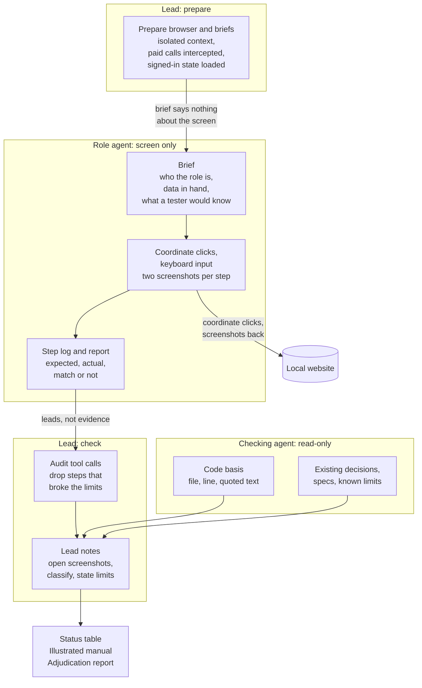
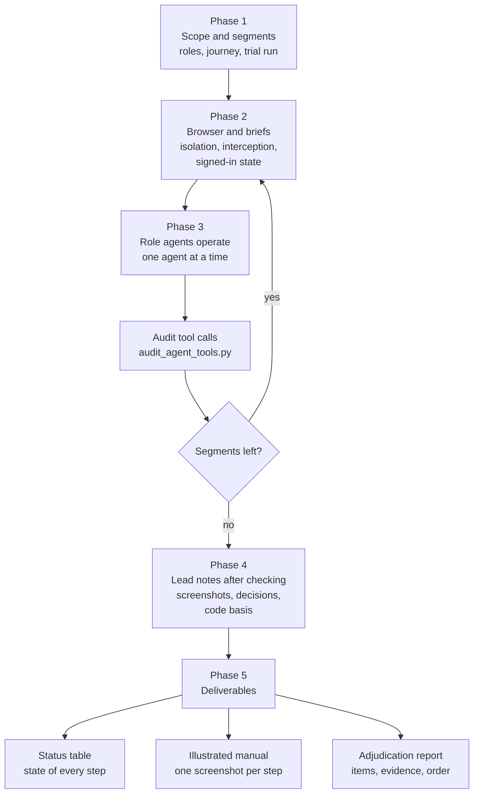

# role-ui-walkthrough

English | [正體中文](README.zh-TW.md)

A usability walkthrough run by role agents that only see the screen. Each role gets one agent that operates a local website through screenshots and coordinate clicks. It does not read the code or the page structure. Wherever it cannot find an entry point, cannot tell what state it is in, or gets no feedback after an action, the screen needs a look. The screenshots it leaves behind are also the raw material for an illustrated user manual.

Three documents come out: a status table, an illustrated manual, and an adjudication report.

## Concept

An agent that has never read the code stands in for a person who has never seen the screen. That only holds when the agent knows exactly what a human tester holding the test brief would know, so the rules of this skill control three things.

**What the agent is given.** The brief contains only what the role knows: who the role is, the data in hand, and the process facts any tester would be told (who approves, which role has to act first). Nothing about the screen goes in: no button names or positions, no URL paths, no field order. Tasks are stated as goals ("find his application and approve it"), not as operations ("open the left menu and press Approve").

**What the agent can do.** Coordinate clicks, keyboard input, screenshots, and reading its own screenshots. No element locators, no reading page content, no typing URLs. After it finishes, a script audits its tool-call log; steps that broke the limits are not used as evidence.

**How the agent's report is used.** The report and the step log are leads, not evidence. An agent misreads small text and misses a screen that shows for two seconds, so every finding is confirmed by opening the screenshot before it is listed. A "nothing appeared" finding needs both screenshots of that step (0.3 s and 2 s after the action) plus a look at the front-end code. Each finding is then checked against the project's existing decisions and specs; a design that was already decided is not listed as a problem.

### Who sees what



| | Sees | Does not see |
| --- | --- | --- |
| Role agent | The brief, its own screenshots | Code, page structure, URL paths, credentials of privileged accounts |
| Lead | Everything: project rules, screenshots, agent reports, check results | — |
| Checking agent | Code, decision records, specs (read-only) | The browser |

## Flow



- **Segments.** The journey is laid out as segments with dependencies. Where a precondition is fulfilled by another role, the agent stops and waits; the handoff is done by another role agent or by the lead. One agent is capped at about 60 steps at desktop width (1280×720) and about 100 steps at phone width (390×844); beyond that the work is split across agents.
- **Trial run.** The first run on a project starts with one segment to confirm that screenshot-only operation works there, that interception holds, and that steps and token use are in the expected range. Then it widens.
- **Stuck.** When the same thing fails to match expectations three times in a row, or nothing on the screen looks like a relevant entry point, the agent stops and reports. The lead gives no location hint the first time, and only the minimum needed to continue the second time. Getting stuck is a finding in itself, whether or not the entry point is found later.
- **Checking.** A read-only checking agent compares every rough spot with existing decisions and specs and finds the code basis. The lead opens the screenshots, removes false reports, and writes the lead notes. The three deliverables use the lead notes as their only source.

## Example

The excerpts below are translated from the example files under `templates/` (the files themselves are in Traditional Chinese). The system is a fictional book-club platform.

**Brief excerpt** ([`templates/role-brief.example.md`](templates/role-brief.example.md)):

```md
## The process you already know (every tester knows this)
1. After a member signs up through an invitation link, the account needs approval.
   The inviting host or an administrator can approve it.
2. Once approved, the member signs in, joins your book club and pays
   (payment succeeds automatically during testing).
3. After the member pays, the host has to press "Start" for the term to begin.

The member side is operated by someone else. Beyond the above, you do not know
what any screen looks like or where any button is.

## What to do
Round 1: Lin messaged you that he has signed up. Find his application and approve it. Then stop and report.
Round 3: Find the reflection he submitted this week and reply. Then answer:
- How many members' reflections are waiting for your reply? Where on the screen do you see that?
- Where will the member see your reply? Can you tell from the screen?
```

Every round ends with questions about whether the screen answered something. Findings such as "the result is visible but the information is not enough" and "no feedback after the action" mostly come from these answers.

**Segment table:**

| Segment | Role agent | Precondition | Handoff |
| --- | --- | --- | --- |
| 1 Sign up, create a book club and submit it, get the invitation link | Host A (3 rounds) | none | Account and book-club approval done by the admin agent |
| 2 Approve the host, approve the book club | Admin (2 rounds) | Segment 1 submitted | Lead tells Host A to continue |
| 3 Member signs up, joins and pays, submits one reflection | Member | Invitation link (read back by the lead) | Approval and start done by the lead |
| 4 Approve, start, set the weekly schedule, reply to the reflection | Host B (3 rounds) | Each stage of segment 3 | Member side done by the lead |

**Status table excerpt** ([`templates/walkthrough-notes.example.md`](templates/walkthrough-notes.example.md)):

| # | Journey step | Role | State | Basis in one sentence |
| --- | --- | --- | --- | --- |
| 2 | Approve the host | Admin | Completed, with obstacles | No result message after pressing "Approve"; confirmed only after going back to the list |
| 4 | Member signs up, joins and pays | Member | Completed | The payment-complete screen is shown and clear |
| 5 | Host starts the term | Host | Completed after getting stuck | Could not find "Start" on the member page, stopped after three mismatches; no hint given, found it on the dashboard six steps later |
| 6 | Member sees the reply | Member | Result visible, information not enough | The reply appears under the reflection; no notification, no reply time |

**One adjudication item:**

```md
**D1 The "Start" button exists only on the dashboard** | Blocking | Change the screen directly
- Fact: The member page header and the member card both show a "Waiting for host to start" label
  but no button; "Start" is only in the "To start" block of the dashboard. The agent failed to find
  it on the member page three times and stopped; no hint was given, and it took six more steps.
- Screenshots: host-02/008, 009, 011 (label without a button); host-02/017 (the dashboard button).
- Code: `StartPeriodButton` is used only by `resources/js/pages/host/Dashboard.tsx:212`.
- Existing decisions and records: none found (searched "Start", "Waiting for host to start", "StartPeriod").
- To decide: nothing. Engineering suggestion: put the same button wherever the label is shown.
```

## Deliverables

| Document | Content |
| --- | --- |
| Status table | One row per journey step: state, one-sentence basis, link to the manual; plus a journey map, what was not operated, and limits on interpretation |
| Illustrated manual | One block per role, written along the path the agent actually completed, one screenshot per step; for steps where the agent got stuck, the manual states the correct entry point |
| Adjudication report | One card per finding: fact, screenshots, code basis, existing decisions, what needs deciding; the first screen is the suggested order of decisions |

Each journey step gets one of five states:

| State | Definition |
| --- | --- |
| Completed | No stop, no repeated mismatch, and the screen answered what it should |
| Completed, with obstacles | Done, but an entry point had to be guessed, guidance was missing, a refresh was needed, or a wrong click happened |
| Completed after getting stuck | The agent reported being stuck, then finished with or without a hint |
| Result visible, information not enough | The action completed, but the agent could not answer the "did the screen tell you" questions |
| Not completed | Not finished even with a hint, or the screen has no entry point for the feature |

Each finding is also labelled with its relation to closing (blocking / scope must be written down / can be a separate case) and its change type (spec plus tests / change the screen directly / diagnose first / automated check). Product-behaviour choices are listed as options with facts; the flow does not decide them for you.

## Requirements

- The orchestrate-kit plugin installed ([install](../../../../README.md#install)). Phase 4 checks with `opus-lite-explorer`, Phase 5 produces the documents through `/orchestrate-kit:orchestrate-v2`, and the adjudication report follows `orchestrate-kit:gap-adjudication-report`.
- Playwright MCP. The brief template and the audit script use the tool names `mcp__playwright__browser_run_code_unsafe`, `browser_tabs`, `browser_file_upload` and `browser_handle_dialog`; if your version names them differently, adjust the template and the allowlist in `audit_agent_tools.py` together.
- [`uv`](https://docs.astral.sh/uv/) and Python 3.10+ (the two scripts have no third-party dependencies).
- A local environment that is safe to operate: a local website, test data that can be rebuilt, test accounts that can be purged.
- Project rules (`CLAUDE.md` or similar) that state: environment checks, how test accounts are named and purged, endpoints that cost money or send something out, UX criteria and existing decisions. This skill stores no project-specific data; whatever the project rules do not state, the flow asks you first.
- Optional: the `diagram-design` plugin for the journey map in the status table; without it the map is drawn as inline SVG directly.

## Usage

```
/orchestrate-kit:role-ui-walkthrough <roles, the journey to walk, the deliverables you want>
```

For example:

```
/orchestrate-kit:role-ui-walkthrough host, admin and member; from sign-up to the host's first reply to a reflection; status table and manual
```

## Cost and limits

- **Usage.** Measured reference values: 48 steps at phone width took about 150k tokens, 104 tool calls and about 13 minutes; 57 steps at desktop width reached about 220k tokens.
- **One agent at a time.** Playwright MCP acts on the current tab, so only one agent operates the browser at any moment. Checking agents that only read code and documents can run in parallel.
- **Prior knowledge.** A subagent automatically loads the project's rule files and memory index, and tool limits do not cover that. The brief asks the agent to mark any prior knowledge it used; this goes into the limits on interpretation.
- **Coverage.** Only the screens the journey passed through are covered. It is not a page-by-page sweep; features that were not operated are listed in the status table.
- **Paid and outbound calls.** In the exploration round they are intercepted on the browser context and answered with fixed responses; the manual notes this where such screens are used. Before switching to real calls the flow reports the count and the cost.
- **Clipboard.** The browser shares the clipboard with the machine it runs on, so the brief forbids clipboard keys. When the audit lists such a step, the related screenshots are not opened and you decide whether to delete or keep them.
- **Screenshot content.** The deliverables contain screenshots of your system. Confirm the content can be public before publishing them anywhere outside your machine.

## Files

Skill files are written in Traditional Chinese (see [Language](../../../../README.md#language)).

| Path | What it is |
| --- | --- |
| `SKILL.md` | The five-phase flow |
| `rules/分段與角色任務說明判準.md` | What goes into a brief and what stays out; segments, stop conditions, safety limits, trial run |
| `rules/瀏覽器準備與交接.md` | Run directory, isolated contexts, interception, signed-in state, two screenshots per step, handoffs and hints, what to do after the audit |
| `rules/發現查證與分類.md` | Confirming with screenshots, comparing with existing decisions, code basis, the five states, relation to closing, change type |
| `rules/產出內容與交付檢查.md` | Content of the three deliverables, how screenshots are used, pre-delivery checks |
| `templates/role-brief.md`, `role-brief.example.md` | Skeleton and example of a role agent's brief |
| `templates/walkthrough-notes.md`, `walkthrough-notes.example.md` | Skeleton and example of the lead notes |
| `scripts/audit_agent_tools.py` | Audits a role agent's tool calls |
| `scripts/check_report_html.py` | Static checks for the produced HTML |

## Using the scripts on their own

```sh
# Audit a subagent transcript: tools outside the allowlist, element locators, reading files other than screenshots, URLs not allowed, clipboard keys
uv run scripts/audit_agent_tools.py --transcript <subagent jsonl> --run-dir <run directory> [--allow-goto <URL prefix> ...]

# Check a produced HTML file: image and link targets exist, anchors resolve, no external resources, image attributes complete
uv run scripts/check_report_html.py <html file> [--ids <id,...>] [--require-hrefs <href,...>] [--forbid <fragment> ...]
```

Full options and exit codes are in the docstring at the top of each script.
