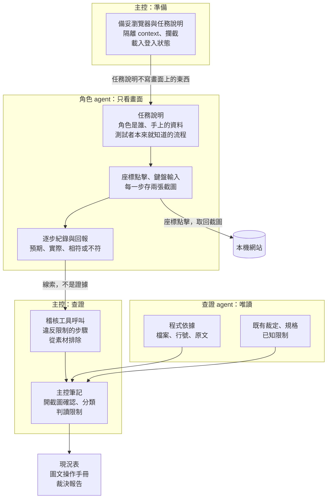
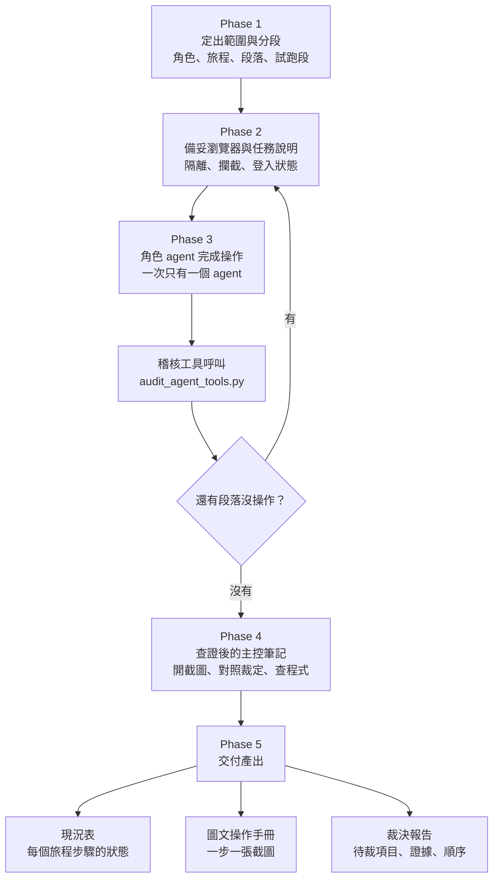

# role-ui-walkthrough

[English](README.md) | 正體中文

派角色 agent 只看畫面操作系統的操作測試。每個角色一個 agent，只靠截圖與座標點擊操作本機網站，不讀程式碼，也不讀頁面結構；它找不到入口、看不懂狀態、等不到回饋的地方，就是畫面要檢查的地方。操作留下的截圖同時是圖文操作手冊的素材。

產出三份文件：現況表、圖文操作手冊、裁決報告。

## 概念

沒讀過程式碼的 agent 用來代替沒看過畫面的人。這個做法成立的條件是 agent 手上的資訊與一位拿到測試說明的人類測試者相同，所以整個 skill 的規則都在控制三件事。

**agent 拿到什麼。** 任務說明只寫角色知道的事：角色是誰、手上的資料、測試者本來就會被告知的流程（誰審核、哪個角色要先做哪件事）。畫面上的東西一律不寫：按鈕名稱與位置、網址路徑、欄位順序。要完成的事用目的陳述（「找到他的申請並核准」），不用操作陳述（「到左側選單按核准」）。

**agent 能做什麼。** 只有座標點擊、鍵盤輸入、截圖，以及讀自己截的圖。不能用元素定位、不能讀頁面內容、不能自己輸入網址。結束後由腳本稽核它的工具呼叫紀錄，違反限制的步驟不當作證據。

**agent 的回報怎麼用。** 回報與逐步紀錄是線索，不是證據。agent 會看錯小字，也會錯過只顯示兩秒的畫面，所以每項發現列入之前都要開截圖確認；「沒有出現」類的發現要看動作後 0.3 秒與 2 秒兩張截圖，並查前端程式。每項發現再對照專案的既有裁定與規格，定案的設計不列為問題。

### 誰看得到什麼



| | 看得到 | 看不到 |
| --- | --- | --- |
| 角色 agent | 任務說明、自己截的圖 | 程式碼、頁面結構、網址路徑、高權限帳號的帳密 |
| 主控 | 全部：專案規則、截圖、agent 的回報、查證結果 | — |
| 查證 agent | 程式碼、決策紀錄、規格（唯讀） | 瀏覽器 |

## 流程



- **分段**：旅程排成有先後依賴的段落。前置條件由其他角色完成的地方，就是 agent 停下等待的地方；交接由另一個角色 agent 或主控完成。一個 agent 在桌機寬度（1280×720）約 60 步、手機寬度（390×844）約 100 步為上限，超過就拆成多個 agent。
- **試跑**：專案第一次執行先選一段試跑，確認只靠截圖操作得了、攔截有效、步數與 token 用量在預期內，再擴大。
- **卡住**：同一件事連續 3 次結果與預期不符，或畫面上找不到任何看起來相關的入口，agent 就停下回報。主控第一次不給位置提示，第二次才給到能繼續的最小程度。卡住本身是一項發現，不論之後有沒有找到入口。
- **查證**：唯讀的查證 agent 把每項不順對照既有裁定與規格，並找出程式依據；主控開截圖確認、排除誤報，寫成主控筆記。三份產出只以主控筆記為來源。

## 範例

以下內容取自 `templates/` 的範例檔，是虛構的讀書會平台「書會通」。

**任務說明節錄**（[`templates/role-brief.example.md`](templates/role-brief.example.md)）：

```md
## 你事先知道的流程（測試人員都知道）
1. 會員用邀請連結註冊後，帳號要審核，邀請的帶領人或管理者都可以審核。
2. 審核通過後，會員登入、報名你的讀書會並付款（測試期間付款自動成功）。
3. 會員付款後，帶領人要按「開始」，這一期才正式開始。

會員那一側由別人操作。除了以上，你不知道任何畫面長什麼樣、按鈕在哪裡。

## 要完成的事
第一輪：林書豪傳訊息說他註冊好了。請找到他的申請並核准。然後停下回報。
第三輪：找到他這週交的心得並回覆。然後回答：
- 現在有幾位會員的心得在等你回覆？你從畫面哪裡看出來？
- 會員會在哪裡看到你的回覆？你從畫面上知道嗎？
```

每一輪都附「畫面有沒有回答」的問題。「看得到結果但資訊不足」「動作後沒有回饋」這類發現主要來自這些回答。

**段落表**：

| 段落 | 角色 agent | 前置條件 | 交接 |
| --- | --- | --- | --- |
| 1 註冊、開讀書會送審、取得邀請連結 | 帶領人甲（3 輪） | 無 | 帳號審核、讀書會審核由管理者 agent 做 |
| 2 審核帶領人、審核讀書會 | 管理者（2 輪） | 段落 1 送出 | 主控通知帶領人甲繼續 |
| 3 會員註冊、報名付款、交一篇心得 | 會員 | 邀請連結（主控讀回） | 核准與開始由主控代做 |
| 4 核准、開始、設定進度、回覆心得 | 帶領人乙（3 輪） | 段落 3 各階段 | 會員側由主控代做 |

**現況表節錄**（[`templates/walkthrough-notes.example.md`](templates/walkthrough-notes.example.md)）：

| # | 旅程步驟 | 角色 | 狀態 | 一句話依據 |
| --- | --- | --- | --- | --- |
| 2 | 審核帶領人 | 管理者 | 做得完，有阻礙 | 按「通過」後沒有結果訊息，要回列表才確認 |
| 4 | 會員註冊、報名付款 | 會員 | 做得完 | 付款完成畫面有顯示，內容清楚 |
| 5 | 帶領人開始這一期 | 帶領人 | 卡住後做得完 | 在會員頁找不到「開始」，連續 3 次不符後停下；沒給提示，又花 6 步在儀表板找到 |
| 6 | 會員看到回覆 | 會員 | 看得到結果但資訊不足 | 心得下方出現回覆，沒有通知、沒有回覆時間 |

**一項裁決項目**：

```md
**D1 「開始」的按鈕只在儀表板**｜阻擋｜畫面直接改
- 事實：會員頁上方、會員卡片都顯示「待帶領人開始」的標籤，但沒有按鈕；「開始」只在儀表板的「待開始」區塊。
  agent 在會員頁連續 3 次找不到後停下，沒給提示，又花 6 步才找到。
- 截圖：host-02/008、009、011（會員頁有標籤沒有按鈕）；host-02/017（儀表板的按鈕）。
- 程式：`StartPeriodButton` 只被 `resources/js/pages/host/Dashboard.tsx:212` 使用。
- 既有裁定與紀錄：查無（搜尋過「開始」「待帶領人開始」「StartPeriod」）。
- 要裁定的事：沒有待裁定的事。工程視角建議：顯示「待帶領人開始」標籤的地方都放同一個按鈕。
```

## 產出

| 文件 | 內容 |
| --- | --- |
| 現況表 | 一列一個旅程步驟：狀態、一句話依據、到手冊的連結；附旅程圖、沒有操作的範圍、判讀限制 |
| 圖文操作手冊 | 每個角色一個區塊，照 agent 實際走通的路徑寫，一步一張截圖；agent 卡住過的步驟直接寫正確的入口 |
| 裁決報告 | 每項發現一張卡片：事實、截圖、程式依據、既有裁定、要裁定的事；第一屏是建議的裁決順序 |

每個旅程步驟的狀態只用五種：

| 狀態 | 定義 |
| --- | --- |
| 做得完 | 沒有停下、沒有連續不符，畫面回答了該回答的問題 |
| 做得完，有阻礙 | 做完了，但過程中有入口要猜、說明不足、要重新整理、點錯等情形 |
| 卡住後做得完 | 曾經回報卡住，沒給提示或給了提示後做完 |
| 看得到結果但資訊不足 | 動作完成，但 agent 回答不出「畫面有沒有告訴你」的問題 |
| 做不完 | 給了提示仍做不完，或畫面上沒有這個功能的入口 |

每項發現另外標收尾關係（阻擋／範圍須明文／可另案）與修改類別（規格＋測試／畫面直接改／診斷後修／自動檢查）。產品行為的選擇只列選項與事實，不代為裁定。

## 需求

- 已安裝 orchestrate-kit plugin（[安裝方式](../../../../README.zh-TW.md#安裝)）。Phase 4 的查證用 `opus-lite-explorer`，Phase 5 的文件由 `/orchestrate-kit:orchestrate-v2` 產出，裁決報告依 `orchestrate-kit:gap-adjudication-report`。
- Playwright MCP。任務說明樣板與稽核腳本用到的工具名稱是 `mcp__playwright__browser_run_code_unsafe`、`browser_tabs`、`browser_file_upload`、`browser_handle_dialog`；你安裝的版本工具名稱不同時，樣板與 `audit_agent_tools.py` 的允許清單要一併調整。
- [`uv`](https://docs.astral.sh/uv/) 與 Python 3.10 以上（兩支腳本沒有第三方相依）。
- 一個可以放心操作的本機環境：本機網站、可重建的測試資料、清得掉的測試帳號。
- 專案規則檔（`CLAUDE.md` 等）寫明：環境檢查、測試帳號的命名與清除方式、付費或會對外發送的 endpoint、UX 判準與既有裁定。這個 skill 不記單一專案的資料；專案規則沒有寫明的事，流程會先問你。
- 選配：`diagram-design` plugin，用來畫現況表的旅程圖；沒有安裝時直接畫 inline SVG。

## 使用

```
/orchestrate-kit:role-ui-walkthrough <角色、要走的旅程、要的產出>
```

例：

```
/orchestrate-kit:role-ui-walkthrough 帶領人、管理者、會員三個角色，從註冊走到帶領人第一次回覆心得；要現況表與操作手冊
```

## 成本與限制

- **用量**：實測參考值，手機寬度 48 步約 15 萬 tokens、104 次工具呼叫、約 13 分鐘；桌機寬度 57 步約 22 萬 tokens。
- **一次一個 agent**：Playwright MCP 的操作對象是目前分頁，同一時間只有一個 agent 操作瀏覽器；只讀程式與文件的查證 agent 可以並行。
- **事先知識**：subagent 會自動載入專案的規則檔與記憶索引，工具限制管不到這一項。任務說明要求 agent 標出用到的事先知識，寫進判讀限制。
- **涵蓋範圍**：只涵蓋旅程經過的畫面，不是逐頁全掃；沒有操作的功能會逐項列在現況表。
- **付費與對外呼叫**：探索回合在 context 上攔截成固定回應；手冊裡用到這些畫面時會註明。改用真實呼叫前，流程會先報次數與費用。
- **剪貼簿**：瀏覽器與執行的電腦共用剪貼簿，任務說明禁止剪貼簿按鍵；稽核列出這類步驟時，相關截圖不開啟，由你決定刪除或保留。
- **截圖內容**：產出含系統截圖，發布到本機以外的地方之前先確認內容可以公開。

## 檔案

| 路徑 | 說明 |
| --- | --- |
| `SKILL.md` | 五個 Phase 的流程 |
| `rules/分段與角色任務說明判準.md` | 任務說明寫什麼、不寫什麼；分段、停下條件、安全限制、試跑 |
| `rules/瀏覽器準備與交接.md` | run 目錄、隔離 context、攔截、登入狀態、每步兩張截圖、交接與提示、稽核後的處理 |
| `rules/發現查證與分類.md` | 開截圖確認、對照既有裁定、程式依據、五種狀態、收尾關係、修改類別 |
| `rules/產出內容與交付檢查.md` | 三份產出的內容、截圖取用、交付前檢查 |
| `templates/role-brief.md`、`role-brief.example.md` | 角色 agent 任務說明的骨架與範例 |
| `templates/walkthrough-notes.md`、`walkthrough-notes.example.md` | 主控筆記的骨架與範例 |
| `scripts/audit_agent_tools.py` | 稽核角色 agent 的工具呼叫 |
| `scripts/check_report_html.py` | 產出 HTML 的靜態檢查 |

## 腳本單獨使用

```sh
# 稽核一個 subagent 的 transcript：允許清單外的工具、元素定位、讀截圖以外的檔案、未允許的網址、剪貼簿按鍵
uv run scripts/audit_agent_tools.py --transcript <subagent 的 jsonl> --run-dir <run 目錄> [--allow-goto <網址前綴> ...]

# 檢查產出的 HTML：圖片與連結目標存在、錨點對得上、沒有外部資源、圖片屬性齊全
uv run scripts/check_report_html.py <html 檔> [--ids <id,...>] [--require-hrefs <href,...>] [--forbid <片段> ...]
```

兩支腳本的完整參數與結束碼寫在檔案開頭的說明。
